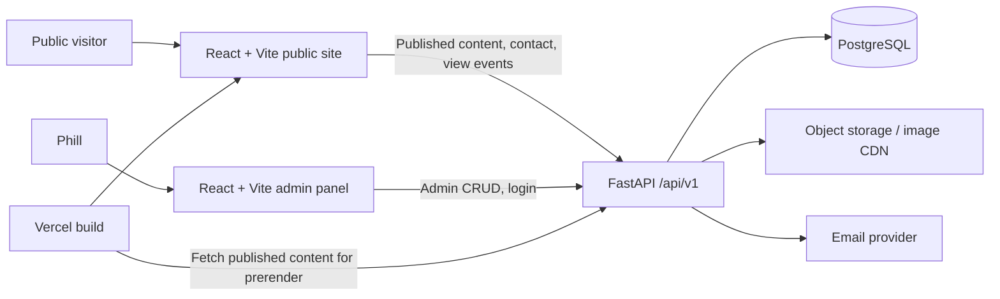
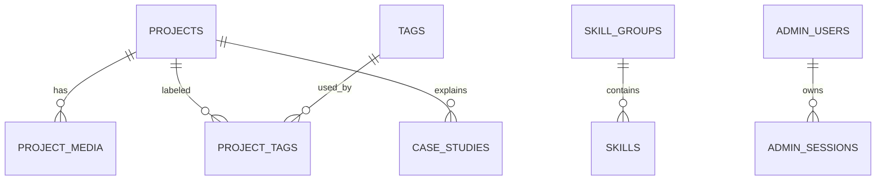

# Phill's Personal Digital Portfolio & Work Lab

## 1. Product scope

The site is a public portfolio and a small content management system. The public site presents work, experience, skills, and writing. An authenticated admin panel manages that content and contact messages. The backend is Python and FastAPI; there is no Node application server.

### MVP

- Public pages for home, work, case studies, data lab, build lab, leadership, about, now, and contact.
- Admin login and CRUD for projects, case studies, experience, leadership, skills, certificates, articles, and site settings.
- Contact form that validates, stores, and rate-limits messages.
- Responsive, accessible UI, basic SEO metadata, and a simple privacy-conscious usage summary.

### Not required for the first release

- Public visitor accounts, comments, or a general-purpose CMS.
- JWT-based public authentication. Only administrators sign in.
- Storing large image/video binaries in PostgreSQL. Store files in object storage and keep metadata/URLs in the database.

## 2. System architecture



### Components and responsibilities

| Component | Responsibility |
| --- | --- |
| React + Vite + TypeScript | Public pages and `/admin`; shared design system and typed API client. |
| Tailwind CSS, Framer Motion, Lucide | Styling, restrained page transitions, and iconography. |
| FastAPI | Versioned REST API, validation, authorization, contact handling, and admin operations. |
| Pydantic | Request/response schemas and validation at the API boundary. |
| SQLAlchemy 2 + Alembic | PostgreSQL mapping and schema migrations. |
| PostgreSQL | Structured published content, admin identity/session data, contact messages, and minimal analytics. |
| Object storage + image CDN | Project screenshots, certificate scans, and article images. Only URLs and descriptive metadata live in PostgreSQL. |
| Email provider | Optional notification when a new contact message arrives; the message is persisted first. |

### Public delivery and SEO

Public portfolio content is mostly editorial and should be rendered into static HTML during the Vercel build. The build fetches published content from FastAPI and prerenders each known public route, including project and case-study slugs. This keeps first loads fast and gives crawlers page content and metadata without requiring the browser to fetch every page's core copy. A published-content change can call a Vercel deploy hook to rebuild the site. Contact submission and optional view-event collection remain runtime API calls. If build-time prerendering proves too awkward for the chosen Vite setup, validate that constraint before implementation rather than silently shipping an SEO-poor client-only shell.

The admin area is a client-rendered app behind authentication and is excluded from indexing. API responses for admin routes are never cached publicly. Published public responses can use CDN caching with an explicit invalidation or short TTL policy.

### Environments and deployment

- **Frontend:** Vercel static deployment, with build-time content fetch/prerender and preview deployments.
- **API:** FastAPI container on Render, Railway, Fly.io, or a VPS. Use one provider for the initial release; keep configuration provider-neutral.
- **Database:** managed PostgreSQL with automated backups and TLS.
- **Media:** object storage with a CDN; uploads restricted by MIME type, file size, and administrator authorization.
- **Configuration:** secrets supplied by deployment environment, never committed. Separate development, preview, and production credentials and databases.
- **Operations:** health endpoint, structured logs, migration step during deployment, error reporting, and a documented backup/restore path.

## 3. Repository and frontend structure

```text
frontend/
  src/
    app/                 # router, providers, shared layout
    components/          # navigation, cards, forms, typography, primitives
    features/
      projects/
      case-studies/
      data-lab/
      contact/
      admin/
    pages/               # route-level pages
    lib/                 # API client, validation helpers, SEO helpers
    styles/
    types/               # API-derived/shared TypeScript types
  scripts/               # build-time content fetch and prerender support
backend/
  app/
    api/v1/               # routers and dependencies
    core/                 # settings, security, logging
    db/                   # engine, session, base model
    models/               # SQLAlchemy models
    schemas/              # Pydantic request/response schemas
    services/             # publishing, uploads, contact, analytics
  alembic/                # migrations
  tests/
docs/
```

The frontend and backend may live in one repository and deploy independently. Keep API types explicit; generate a TypeScript client from FastAPI's OpenAPI schema once the endpoints stabilize, or maintain a small typed client in the first iteration.

## 4. Public page and route structure

| Route | Purpose and primary content | Data source |
| --- | --- | --- |
| `/` | Intro, featured work, focus areas, selected proof points, contact CTA | Published settings, featured projects, skills |
| `/work` | All projects with category/tag filters | Published projects |
| `/work/:slug` | Project detail, role, stack, links, media, outcomes | Published project |
| `/case-studies` | Case study index | Published case studies |
| `/case-studies/:slug` | Long-form problem, approach, decisions, results | Published case study and linked project |
| `/data-lab` | Data projects and interactive visualizations | Published projects with `data` category, optional visualization config |
| `/build-lab` | Experiments and prototypes | Published projects with `experiment` category |
| `/leadership` | Leadership, community, and activities | Published leadership entries |
| `/about` | Bio, interests, working approach, skills | Site settings and published skills |
| `/now` | Current focus and availability | Site settings; optionally dated update entries later |
| `/contact` | Contact form and public contact links | Site settings; POST to API |
| `/admin/login` | Administrator sign-in | FastAPI auth endpoint |
| `/admin` | Private overview and recent messages/content summary | Admin API |
| `/admin/projects` and `/admin/projects/:id` | Project list, editor, media, publish status | Admin API |
| `/admin/case-studies` and `/admin/case-studies/:id` | Case study list and editor | Admin API |
| `/admin/experience` | Experience entries editor | Admin API |
| `/admin/leadership` | Leadership entries editor | Admin API |
| `/admin/skills` | Skills and grouping editor | Admin API |
| `/admin/certificates` | Certificate editor | Admin API |
| `/admin/articles` and `/admin/articles/:id` | Article list and editor | Admin API |
| `/admin/messages` and `/admin/messages/:id` | Inbox, status, and message detail | Admin API |
| `/admin/settings` | Profile, navigation, social links, SEO defaults | Admin API |

For the initial release, keep “Web”, “Data”, “Cloud”, and “Experiments” as project categories/tags rather than separate project tables. “Data Lab” and “Build Lab” are curated views over those projects. This keeps content entry simple while allowing dedicated pages later.

## 5. Database schema

Use UUID primary keys, UTC timestamps, database constraints for uniqueness and valid states, and explicit `draft`/`published` state on editorial content. Public queries return only published records. Slugs are unique and stable; changing a published slug should either be blocked or create a redirect record.

### Core editorial tables

| Table | Important fields and relationships |
| --- | --- |
| `projects` | `id`, `title`, unique `slug`, `summary`, `body` (Markdown or structured blocks), `category`, `status`, `featured`, `role`, `started_on`, `completed_on`, `repository_url`, `live_url`, `sort_order`, `published_at`, timestamps. One-to-many media; many-to-many tags; optionally one-to-one/one-to-many case studies. |
| `project_media` | `id`, `project_id`, `url`, `alt_text`, `caption`, `media_type`, `sort_order`, timestamps. `project_id` cascades on project deletion. |
| `tags` | `id`, unique `slug`, `label`. Shared by projects and optionally case studies through join tables. |
| `project_tags` | Composite key (`project_id`, `tag_id`); indexes both foreign keys. |
| `case_studies` | `id`, optional `project_id`, `title`, unique `slug`, `summary`, `problem`, `approach`, `decisions`, `outcomes`, `status`, `featured`, `sort_order`, `published_at`, timestamps. Keep structured sections as Markdown/text initially; avoid a generic block-builder until needed. |
| `experience_entries` | `id`, `organization`, `title`, `location`, `description`, `started_on`, nullable `ended_on`, `status` or `is_current`, `sort_order`, `published_at`, timestamps. |
| `leadership_entries` | `id`, `organization`, `title`, `description`, `started_on`, nullable `ended_on`, `url`, `sort_order`, `published_at`, timestamps. |
| `skill_groups` | `id`, `name`, `slug`, `sort_order`. |
| `skills` | `id`, `skill_group_id`, `name`, optional `proficiency_label`, optional `icon_key`, `sort_order`, `published_at`. Avoid numeric proficiency bars unless there is a meaningful, consistent scale. |
| `certificates` | `id`, `name`, `issuer`, `issued_on`, nullable `expires_on`, `credential_url`, `media_url`, `sort_order`, `published_at`, timestamps. |
| `articles` | `id`, `title`, unique `slug`, `excerpt`, `body`, `cover_image_url`, `external_url`, `status`, `published_at`, timestamps. Supports hosted writing or a link to an external article. |
| `site_settings` | Key/value settings with typed validation in the application, e.g. name, headline, bio, social links, contact email, default SEO title/description, availability, current focus. Keep one controlled settings record or a constrained key/value table; do not allow arbitrary code/HTML. |

### Admin, contact, and analytics tables

| Table | Important fields and relationships |
| --- | --- |
| `admin_users` | `id`, unique normalized `email`, `password_hash`, `is_active`, `last_login_at`, timestamps. No public registration. Seed the initial administrator through a one-time CLI command. |
| `admin_sessions` | `id` or opaque token hash, `admin_user_id`, `expires_at`, `created_at`, `last_seen_at`, optional `revoked_at`. Store only a hash of the session token. Revoke on logout/password reset. |
| `contact_messages` | `id`, `name`, `email`, `subject`, `message`, `status` (`new`, `read`, `archived`), `created_at`, optional `read_at`. Keep IP/user-agent out of the message record; if rate-limit tracking needs them, use short-lived, minimized data. |
| `page_view_daily` | `day`, `route_key`, `views`; aggregate counts by day and normalized route. Do not store raw visitor identifiers or full IP addresses. Optional for MVP. |
| `slug_redirects` | `id`, `content_type`, `old_slug`, `new_slug`, unique (`content_type`, `old_slug`), `created_at`. Add if editors can change published slugs. |

### Relationships at a glance



### Data lifecycle and constraints

- Draft records are visible only in authenticated admin responses. Publish timestamp is set when a record first becomes published and updated only by an explicit republish action.
- Deleting a project cascades its media and tag joins. Case studies should be retained or detached if the project is deleted; do not silently cascade long-form content.
- Store dates (experience/certificate dates) as SQL `DATE`, operational/editorial timestamps as timezone-aware timestamps.
- Add indexes to status + publication date, slug, sort order, foreign keys, contact status + creation date, and analytics day.
- Keep Markdown rendering sanitized; reject executable HTML or sanitize it before rendering.

## 6. API outline

Base path: `/api/v1`. Return consistent JSON, use Pydantic response models, and use pagination for list endpoints that can grow. Public routes expose published content only.

### Public endpoints

```text
GET  /projects?category=&tag=&featured=&limit=&cursor=
GET  /projects/{slug}
GET  /case-studies
GET  /case-studies/{slug}
GET  /experience
GET  /leadership
GET  /skills
GET  /certificates
GET  /articles
GET  /articles/{slug}
GET  /site-settings/public
POST /contact
POST /analytics/page-view        # optional, aggregate and rate-limited
```

### Authentication and admin endpoints

```text
POST   /auth/login
POST   /auth/logout
GET    /auth/me
GET    /admin/dashboard
GET    /admin/messages
PATCH  /admin/messages/{id}      # status/read state
GET    /admin/{resource}
POST   /admin/{resource}
GET    /admin/{resource}/{id}
PUT    /admin/{resource}/{id}
DELETE /admin/{resource}/{id}
POST   /admin/media/presign      # if direct-to-object-storage uploads are used
POST   /admin/publish            # optionally trigger frontend rebuild hook
```

Resources initially include projects, case studies, experience, leadership, skills/groups, certificates, articles, and site settings. Add explicit resource routers and authorization; do not expose an unrestricted generic table API.

## 7. Security and reliability decisions

- Prefer opaque server-side admin sessions in `Secure`, `HttpOnly`, `SameSite=Lax` cookies. Keep only a token hash in PostgreSQL. This is simpler to revoke than long-lived JWTs for a single-admin CMS. If frontend/API are on separate sites, plan cookie and CORS domains together; keep them same-site where possible.
- Protect cookie-authenticated mutations with CSRF protection and strict allowed origins. Configure CORS for the exact frontend origins, not `*` with credentials.
- Use Argon2id or a maintained password-hashing library; support password reset through an operator-controlled path initially. Rate-limit login and contact endpoints.
- Validate uploads by size, content type, and generated storage key; never trust a client filename or render uploaded content as HTML.
- Use HTTPS, TLS database connections, least-privilege DB credentials, secret rotation, and automated backups.
- Contact submission stores the message before sending optional notifications. Email failure must not lose the message.
- Provide `/health/live` and `/health/ready`; readiness checks database connectivity without exposing credentials or internal details.

## 8. Implementation sequence and decisions to settle

1. Confirm final content model and initial project categories; seed content can be refined after the schema.
2. Build FastAPI configuration, database session, SQLAlchemy models, Alembic migrations, and public read endpoints.
3. Build the public React design and page templates against typed sample/API data; add build-time prerendering for content routes.
4. Add admin session auth, then CRUD screens and media upload flow.
5. Add contact delivery, deploy frontend/API/database, configure domain/cookies/CORS, backups, logging, and rebuild hook.

Before implementation, choose the initial API host, media provider, email provider, and whether articles are hosted or external links. Those choices affect deployment configuration but not the core content schema. The stack and page model above are the working defaults; this document does not create application code or provision services.
